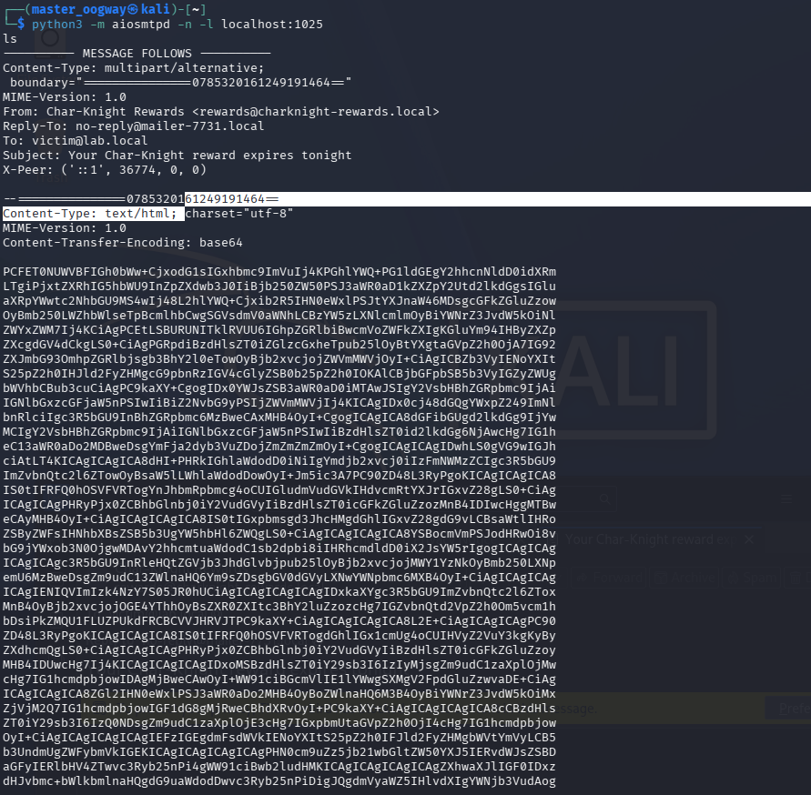
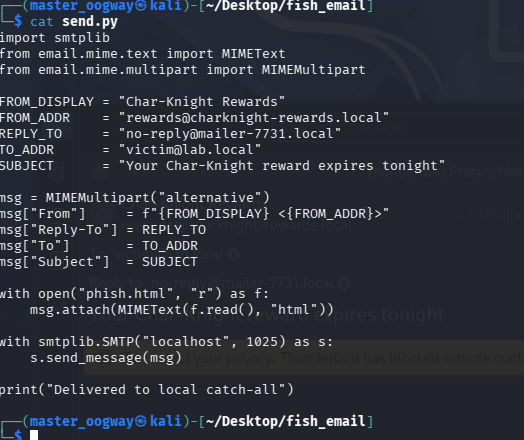

## Phishing email Build
# Goal 
Using the techniques learned in the phishing analysis project along with other researched techniques, i will put them into practice by creating a phishing email. techniques i will use:

- using a lookalike domain to deceive the target.
- obfuscated link
- brand asset from a real source.
- tracking pixel.
- reply-to mismatch, `from` looks legit but if the victim replies it will route to a address i control.

### email sent to the same local host.

1. using Claude i had it built a normal email in HTML format
2. i installed a server to listen on port 1025.
3. started the python program to listen on port 1025.
4. sent the email and the listening port picked it up.

## analysis Header indications

- reply to mismatch between the `from` [[rewards@charknight-rewards.local](mailto:rewards@charknight-rewards.local)] and `reply-to` [no-reply@mailer-7731.local];
- This project cannot display Authentication-Results as there are no `Received-SPF`, no `DKIM-Signature`. As aiosmtpd is a bare catch all with no authentication checking, also both VMs are in the same localhost. In a real case scenario the email would fail SPF and DMARC alignment. This small project shows what would have happened.

## Body techniques

- tempting link 'CLAIM YOUR FREE MEAL' promises the user a reward from a reputable restaurant.
- 'The offer expires at midnight..' creates urgency and emotional pain if the user is not to accept such great offering.
- Credential-Harvest landing- the logo wraps a link to the login page. "verify your account" is where the payload is sitting.

Verdict IOCs: the From, Reply-to, the link host, the Fake domains MITRE ATT&CK: T1566.002 (Spearphishing Link), and T1534 or T1656 for the impersonation angle.

## what i learned?

- everything is sent from the terminal. the script act as the sending mail client, as real mail app won't let you forge From/reply-to, which is why attackers use scripts.
- The email claims to go to `victim@lab.local` but it went wherever the SMTP connection was pointed