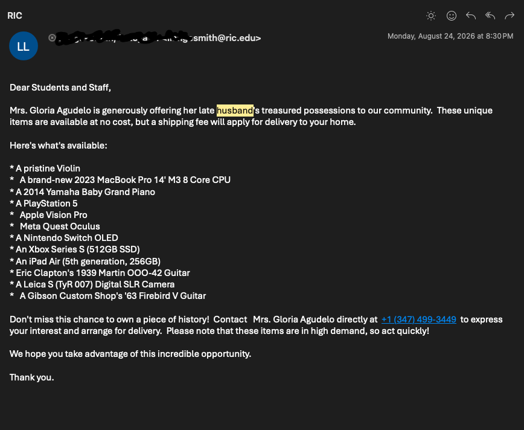
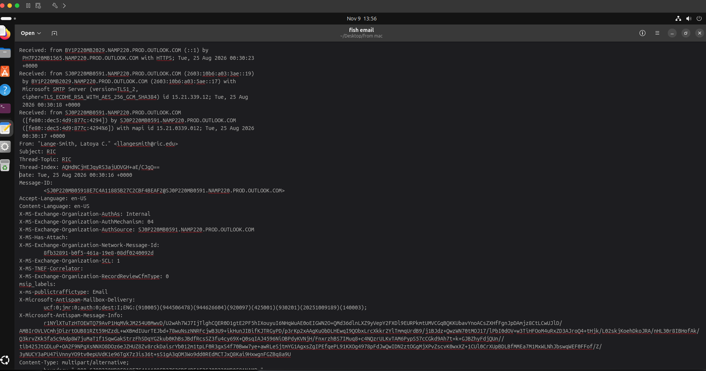

# Sample 01 — Advance-Fee Scam from a Compromised Internal Account

## Setup

1. Transferred the file from my MacBook to my VM to keep any intrusion isolated.

## Header Analysis

### Originating Server

Microsoft Exchange Online (IPv6 link-local address)

### Date

`Tue, 25 Aug 2026 00:30:16 +0000`

- The email came from inside the school. This could be a test or a compromised account, because `NAMP220.PROD.OUTLOOK.COM` are Microsoft servers and all the hops are within the same organization's servers.
- **Evidence:**
    - `X-MS-Exchange-Organization-AuthAs: Internal`
    - `X-MS-Exchange-Organization-SCL: 1`

### From

`[real_staff]@ric.edu`

- Researched the email; it actually belongs to someone within the organization.

### Subject

`RIC`

- Subject is too broad.

### Message-ID

`SJ0P220MB05918E7C4A11885B27C2CBF4BEAF2@SJ0P220MB0591.NAMP220.PROD.OUTLOOK.COM`

- Contains the internal server.

### X-Microsoft-Antispam-Message-Info

I was not able to decode the base64 `X-Microsoft-Antispam-Message-Info` since it is Microsoft proprietary encrypted data.

## Email Body Analysis

- The email uses gifts as the lure; the wording and story give off "an opportunity of a lifetime." Multiple very desirable products, especially by college students.
- This email does not contain the typical email, rather a phone number: `+1 (347) 499-3449`. Searched the number and the name Keith Tood popped up, and on 800notes.com, that phone number has been used for scams before.

## Red Flags

- No `To:` header, often used by mass sends from hijacked accounts.
- `Date: Tue, 25 Aug 2026 00:30:16 +0000` matches the start of the fall semester, when students are checking their emails to stay updated with real classes and events around campus.
- Scam type: advance-fee scam.
- The email offers devices and objects worth thousands of dollars for free, such as a MacBook Pro, Clapton guitar, etc.

## Verdict

**Malicious.** Email using the method of an advance-fee scam. The attacker compromised a legitimate account and used it as a disguise to conduct email scams on their behalf.

**Evidence:**

- The MAPI and internal-auth headers
- Phone number linked to past scams
- The free-items-plus-shipping-fee pattern

## Indicators of Compromise (IOCs)

|Type|Value|
|---|---|
|Phone|+1 (347) 499-3449|
|Sender|`[real_staff]@ric.edu` (compromised account)|
|Message-ID|`SJ0P220MB05918E7C4A11885B27C2CBF4BEAF2@SJ0P220MB0591.NAMP220.PROD.OUTLOOK.COM`|

## MITRE ATT&CK

- **T1566.004** — Spearphishing Voice
- **T1078** — Valid Accounts

## Response

The immediate response to this attack:

1. Reset the password and an MFA review of the account by the IT department.
2. Check for potential rules created by the attacker.
3. Search and remove the email from every account it reached to minimize the attack.

## Lessons Learned

- The `Received` list should be read bottom to top, since the bottom is the sender and the top is the recipient.
- I originally thought the email was spoofed, but I was wrong, because it says MAPI, which is how Outlook itself talks to Exchange. This means someone logged into a legitimate email address and sent it. The most likely explanation is a compromised account.

