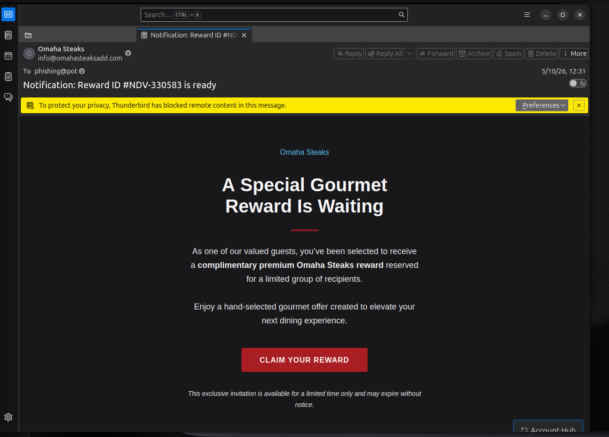
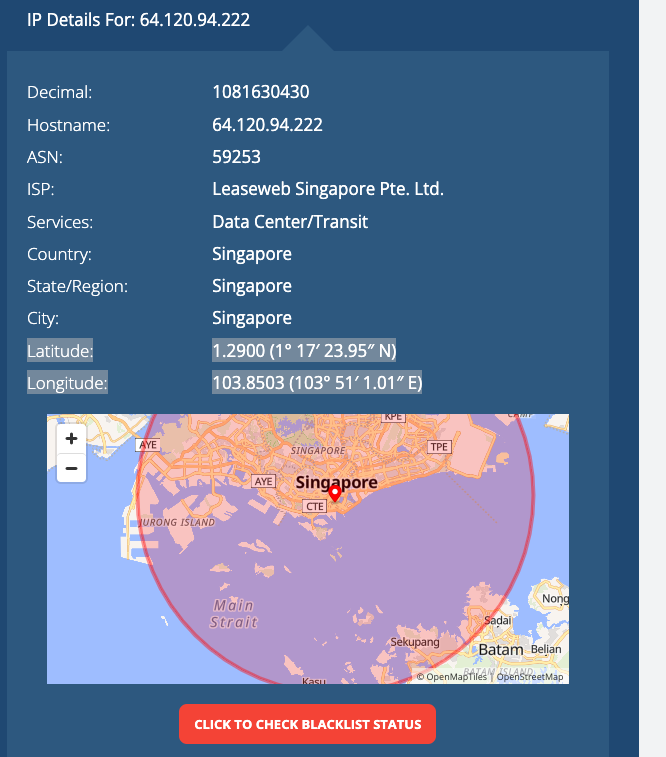

# Phishing Analysis — sample from malware repo

**Analyst:** Adriano
**Date:** 10/10/2026
**Source:** Phishing Pot (`sample-XXXX.eml`)
**Verdict:** Malicious / Suspicious / Benign — *confidence: high / medium / low*

---

## Summary

The email poses as a legitimate steak shop named "Omaha Steaks"; this shop sells premium steak. The email is well crafted using HTML and typical marketing wording.


## Sender and routing

| Field          | Value                                   |
| -------------- | --------------------------------------- |
| From (display) | Omaha Steaks                            |
| From (address) | info@omahasteaksadd[.]com               |
| Return-Path    | z4om46q11a@WisokyCN[.]onmicrosoft[.]com |
| Reply-To       | N/A                                     |
| Sending IP     | 64.120.94.222                           |
| Date           | Sun, 10 May 2026 16:31:52 +0000         |

The message originated from 64.120.94.222 and was relayed through a Microsoft server as `info@omahasteaksadd.com`. There is a return-path, however there is no `reply-to`; this is a red flag because the goal of the attacker is for the user to click `CLAIM YOUR REWARD`. Using whatismyip.com to find the location of the IP, the IP originated in Singapore, more precisely the downtown/central area of the Republic of Singapore. Although the email originated in Singapore, the attacker might have used a VPN to keep his exact location a mystery.

## Authentication

| Mechanism | Result | What it means here                                                                      |
| --------- | ------ | --------------------------------------------------------------------------------------- |
| SPF       | Fail   | It fails at the origin (64.120.94.222) and passes at delivery (52.102.202.63).          |
| DKIM      | None   | (Message not signed.) It is not verified whether the email was altered over transit.    |
| DMARC     | None   | No DMARC record exists for the email's domain, so there is no policy to enforce.        |


## Social engineering

The email utilizes subtle urgency to entice the victim to click the `CLAIM YOUR REWARD` button. This email targets a user or a batch of users who have high interest in the Omaha Steaks shop. The reward technique is also used, since after looking up the steak shop, they seem to sell premium-value steaks.

## Technical indicators

Header anomalies, invisible or mixed-script characters, brand assets loaded from legitimate domains, discrepancies between what is displayed and what is encoded.

- `INFO@OMAHASTEAKSADD.COM` => has an `ADD`, which is an uncommon word to add to a legit business email.
- `hxxp://010036057340/4fwudd22100ATVN232xzhjefotyr80RZCDGLLOAHUNUGM285239YFME433799A1` => is the attached HTTP link with the text CLAIM YOUR REWARD. It is a real HTTP address disguised as a real HTTP address.
- The logo is loaded from Wikimedia to make it look more legitimate.

## Attachment

No attachment was included in this email. Analysis was limited to the headers, body, and links.

## Indicators of compromise

```
Domains:
Hosts / IPs:
URLs (defanged):
File hashes:
Sender addresses:
```

## Assessment and recommendation

This is a phishing email with a malicious link embedded in the button "CLAIM YOUR REWARD". The real Omaha Steaks shop is a US-based company, and the email was sent from Singapore with a masked email address.

The IP address should be blacklisted, users who clicked the link should be isolated from the network, and the steak shop should be contacted and informed of the impersonation and attack being carried out under their legitimate name.

## Limitations

I did not visit the links, so it is unclear whether the link steals login credentials, delivers malware, etc. I am also not able to verify who the real attacker is.

### Lessons learned
- The `return-path` displays the actual sender.
- The bottom `received` often shows the real sender of the email.
- SPF => Sender Policy Framework is a record of IPs that can send emails for a domain.
- After copying a harmful email link, defang it so someone reading the report does not click it by accident, for instance: `hxxp...`
- HTTP links can be disguised.

### Questions and answers
1. How does an attacker hide their real email address behind a legit email?
   - The From line is just text chosen by the sender. The real email address happens with the envelope sender (Return-Path).
2. How do they send the email after not being allowed by the email server?
   - SPF does not block anything; it is only a check the receiving server performs, then that server decides what to do.
